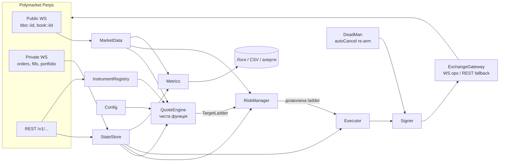
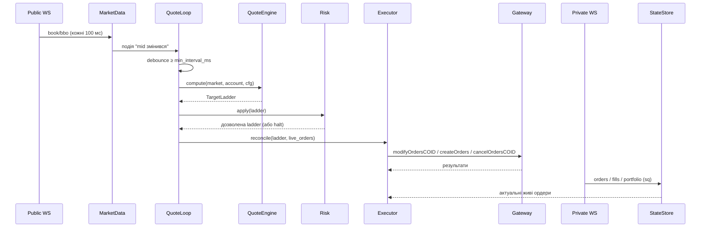

# Perps Quoter — архітектура бота-котирувальника для Polymarket Perps

> Специфікація для самостійної розробки на іншому пристрої.
> Джерело всіх фактів — офіційна документація Polymarket Perps (стан на 2026-10-19).
> Посилання наведено біля кожного розділу. Пункти з позначкою **[перевірити]** документація не підтверджує однозначно.
>
> **Стек: Bun + TypeScript.** Офіційний SDK `@polymarket/client@0.13.0` + `viem` + `@msgpack/msgpack`. Встановлення, імпорт SDK і підпис операцій перевірено в Bun 1.3.14; приклади коду з §8 проходять `tsc --strict`. Мережеві виклики до біржі не перевірялись.

---

## 0. Що робить бот (і чого не робить)

**Робить:**

1. Тримає лімітні **post-only GTC** ордери з обох боків від mid на заданих відстанях у bps і заданих розмірах.
2. Переставляє ордери, коли mid зсувається, через **modify** без зняття ордера, щоб не втрачати uptime.
3. Контролює ризик: ліміт позиції, зсув котирувань проти накопиченої позиції, зупинку при різкому русі ціни чи втраті даних, dead man's switch.
4. Рахує метрики винагород: uptime, notional по діапазонах і оцінку score.

**Не робить:**

- Не торгує в напрямку ринку і не бере ліквідність. Виняток — опційне аварійне закриття позиції reduce-only IOC, за замовчуванням вимкнене.
- Не обходить географічні обмеження (див. §13).

---

## 1. Правила винагород, під які оптимізується бот

Джерело: [Liquidity Rewards](https://docs.polymarket.com/perps/liquidity-rewards).

```
raw_score    = maker_score^0.35 × active_liquidity_score^0.65 × uptime
reward       = raw_score / Σ raw_score(усі мейкери ринку) × market_pool
market_pool  = $75,000 / кількість активних ринків   (за добу, 12:00–12:00 UTC)
maker_score  = ln(1 + min(maker_share, 25%) / 1%) / ln(26)   (0, якщо maker_share < 1%)
```

| Параметр | Значення | Що це означає для бота |
|---|---|---|
| Діапазони від **mid** | 0–5 / 5–10 / 10–20 bps | Ордери далі 20 bps дають 0 |
| Ваги | 1.00 / 0.25 / 0.10 | Основний score дає діапазон 0–5 bps |
| Кап | $100,000 на акаунт / сторону / діапазон / ринок | Більший обсяг у діапазоні не дає score, але займає маржу |
| Об'єднання сторін | гармонійне середнє `2·B·A/(B+A)` | Перекіс між BID і ASK знижує score; одна сторона = 0 |
| Uptime | частка знімків, де є ліквідність **з обох боків** у межах 20 bps | Ніколи не знімати обидві сторони без потреби |
| Межі діапазонів | округлюються назовні до валідного тіку | Цілитися всередину діапазону із запасом |
| Maker share | `account maker volume (7d) / total exchange volume` | Рахується **по всій біржі**: обсяг на інших активах теж іде в залік ([`maker_share_7d`](https://docs.polymarket.com/api-reference/get-account-rewards)) |

**Ключова оптимізація:** усередині діапазону відстань від mid на score не впливає. Ордер на 4 bps дає стільки ж, скільки на 0.5 bps, а виконується значно рідше. Тому стратегія за замовчуванням — ставити ордери біля **зовнішнього краю** кожного діапазону із запасом на коливання mid: ~3.5–4 / ~8–8.5 / ~17–18 bps.

**Суперечність, яку треба тримати в голові:** для участі потрібен maker share ≥1%, тобто реальні виконання. Кожне виконання відкриває позицію. Тож бот має контрольовано набирати maker-обсяг, а не уникати його повністю.

---

## 2. Факти про API, на яких стоїть архітектура

| Тема | Факт | Джерело |
|---|---|---|
| REST base | `https://api.perpetuals.polymarket.com` | [Trading](https://docs.polymarket.com/perps/trading) |
| WebSocket | `wss://ws.perpetuals.polymarket.com/v1/ws` | [Authenticated Sessions](https://docs.polymarket.com/perps/authenticated-sessions) |
| Ключі | Гаманець один раз підписує `createProxy`, далі всі ордери підписує **proxy-ключ** | там само |
| Приватні REST-читання | заголовки `polymarket-proxy`, `polymarket-secret` | там само |
| Строк proxy | за замовчуванням 1 тиждень | там само |
| WS keepalive | ping кожні ~25 с; з'єднання застаріле, якщо ~65 с немає повідомлень; сервер закриває після 60 с тиші | там само + AsyncAPI |
| Стакан (WS) | `book::<iid>` — **знімок** топ-20 (`book::<iid>::50` — топ-50) кожні **100 мс** | AsyncAPI |
| BBO (WS) | `bbo::<iid>` | [Realtime Updates](https://docs.polymarket.com/perps/realtime-updates) |
| Приватні канали | `orders`, `fills`, `portfolio` (кожні 5 с), `balances` (5 с), `funding`, `tpsl` | AsyncAPI |
| Послідовність | кожен фрейм має `sq`; пропуск чи реконект → повний перезбір стану з REST | [Reconcile Trade State](https://docs.polymarket.com/perps/trading#reconcile-trade-state) |
| Типи ордерів | GTC / IOC / FOK; **post-only лише для GTC**; reduce-only для закриття | [FAQ](https://docs.polymarket.com/perps/faq) |
| Post-only відмова | статус `post_only_rejected` | Trading |
| Modify | лише ціна і загальна кількість, тільки для standalone GTC, що вже стоїть у книзі | Trading → Modify Orders |
| Черга при modify | зміна ціни або збільшення кількості → в кінець черги; зменшення кількості на тій самій ціні → черга зберігається | Trading → Queue Priority |
| Ліміт modify | 10,000 успішних змін на один ордер (`modify_limit_reached`) | [Errors](https://docs.polymarket.com/perps/errors) |
| SDK (TS і Python) | **modify поки не підтримується** («SDK support is coming soon»); у `@polymarket/client@0.13.0` методу немає → потрібен власний підписувач (§8) | Trading, `.d.ts` SDK |
| Chase у SDK | `createChase` тримає дочірній ордер на найкращій ціні, щоб набрати обсяг. Для котирування на фіксованій відстані в bps **не підходить** | `.d.ts` SDK |
| Client order ID | 32 символи, lowercase hex, не всі нулі | Trading, Errors |
| Точність | ціна ≤ `price_decimals` і **≤ 5 значущих цифр**; кількість ≤ `quantity_decimals` і ≤ 5 значущих цифр | Errors |
| Підпис | дійсний до 5 хвилин (`signature expired`) | Errors |
| Taker delay | 20 мс для ордерів, що виконуються одразу при вході | [Changelog](https://docs.polymarket.com/changelog/perps) |
| STP | завжди CancelMaker: ваш taker знімає ваш власний resting-ордер | [Self-Trade Prevention](https://docs.polymarket.com/perps/learn-about-trading/self-trade-prevention) |
| Ліміт IP | 1,000 вагових токенів/хв; batch = `1 + floor(n/20)` | [Rate Limits](https://docs.polymarket.com/api-reference/perps/rate-limits) |
| Ліміт дій | 5,000 токенів/хв, до 1,000 відкритих ордерів (базовий тир) | там само |
| Вартість дій | place = 1/ордер, **modify = 1/ордер, cancel = 0, cancelAll = 0**, autoCancel = 10 | AsyncAPI |
| Ліміти інструмента | `max_order_count`, `min_notional`, `max_limit_notional`, `max_leverage`, `risk_tiers`, `price_bounds` | `GET /v1/info/instruments` |
| Dead man's switch | `autoCancel`: дедлайн ≥5 с у майбутньому; спрацьовує один раз; кількість спрацювань на добу обмежена | Trading → Auto Cancel |
| Cancel-only mode | під час обслуговування нові ордери відхиляються з `cancel_only_mode`, cancel працює | Trading → Cancel |
| Маржа | ліміт плеча рахується від **позиції + resting-ордерів на важчій стороні** | [Margin](https://docs.polymarket.com/perps/learn-about-trading/margin) |
| Комісії | maker 0.0125% на базовому тирі; ребейт лише від $1B за 30 днів | [Fees](https://docs.polymarket.com/perps/learn-about-trading/fees) |
| Торгівля 24/7 | перп торгується цілодобово, але для акцій зовнішні ціни вночі й у вихідні бідніші | [Market Sessions](https://docs.polymarket.com/perps/learn-about-trading/market-sessions) |
| Моніторинг акаунта | `/v1/account/stats` (maker share), `/v1/account/rewards` (виплати по ринках), `/v1/account/limits` (ліміти дій), `/v1/account/auto-cancel` (ліміт спрацювань) | [Stats](https://docs.polymarket.com/api-reference/get-account-stats), [Rewards](https://docs.polymarket.com/api-reference/get-account-rewards), [Limits](https://docs.polymarket.com/api-reference/get-account-limits), [Auto-Cancel](https://docs.polymarket.com/api-reference/get-auto-cancel-status) |

---

## 3. Компоненти



| Модуль | Відповідальність | Вхід → вихід |
|---|---|---|
| `Config` | YAML + `.env` (Bun читає `.env` сам), валідація через `zod` | файл → `Settings` |
| `Clock` | різниця з серверним часом через `GET /v1/info/time`; усі `ts` = локальний час + зсув | — → `clock.nowMs()` |
| `InstrumentRegistry` | завантажує інструмент, рахує тік і крок кількості, перевіряє конфіг на ліміти | `/v1/info/instruments` → `Instrument` |
| `MarketData` | публічний WS, `bbo` + `book`; mid, best bid/ask, вік даних, історія mid для volatility breaker | WS → `MarketState` |
| `StateStore` | **єдине джерело правди** про власні ордери (за coid), позицію, маржу; відстежує `sq` | WS + REST → `AccountState` |
| `QuoteEngine` | **чиста функція** без мережі: ринок + позиція + конфіг → цільова сітка | → `TargetLadder` |
| `RiskManager` | обмежує або обнуляє сітку за правилами ризику; вмикає halt | `TargetLadder` → `TargetLadder` |
| `Executor` | порівнює ціль із живими ордерами → modify / place / cancel; token bucket; не більше одного запиту в польоті на ордер | → операції |
| `Signer` | msgpack → keccak256 → EIP-712 `Op` → підпис proxy-ключем (тільки для modify) | compact op → `{sig, salt, ts}` |
| `ExchangeGateway` | place, cancel, cancelAll, autoCancel — через `PerpsSession` з SDK; modify — через власний `Signer` + `fetch`; класифікує помилки | → результати |
| `DeadMan` | re-arm `autoCancel` кожні 20 с з дедлайном +60 с; disarm при штатній зупинці | — |
| `Metrics` | uptime, notional і score по діапазонах, виконання, PnL, оцінка частки; раз на годину `/v1/account/stats` і `/rewards` | → лог / CSV / Prometheus |

---

## 4. Модель виконання (Bun, один процес, event loop)



**Async-задачі** (кожна — окремий `async` цикл, запущений із `main()` без `await`; `Promise.race` ловить падіння будь-якої):

1. `publicReader`: `for await` по `client.subscribe([{ topic: "perps.book", instrumentId }])` (+ BBO) → оновлює `MarketState`.
2. `privateReader`: `for await (const ev of session)` → `order` / `fill` / `portfolio` / `resync` → `StateStore`, стежить за `sq`.
3. `quoteLoop`: запускається від зміни mid з debounce. Це єдиний писач ордерів.
4. `deadmanLoop`: `setInterval` 20 с → `session.armAutoCancel({ cancelAt: now + 60_000 })`.
5. `poller`: `/v1/account/limits` раз на 60 с, `session.fetchStats()` і `/v1/account/rewards` раз на годину, `session.fetchPortfolio()` як запасний шлях.
6. `metricsLoop`: раз на 1 с фіксує uptime і стан діапазонів.

**Правило конкурентності:** ордери змінює тільки `quoteLoop` → `Executor`. Читачі тільки оновлюють стан. Через це немає гонок на кшталт `modify_already_pending`. Обробники `process.on("SIGINT" | "SIGTERM")` запускають штатну зупинку (§10).

---

## 5. QuoteEngine — математика сітки

### 5.1 Опорна ціна
```
mid = (best_bid + best_ask) / 2     # rewards міряють відстань саме від mid
```
Якщо однієї сторони стакану немає або дані старші за `stale_book_ms`, сітка порожня. Тоді RiskManager знімає ордери.

### 5.2 Тік і крок кількості
```
tick(price)  = max(10^-price_decimals, 10^(floor(log10(price)) - 4))   # обмеження на 5 значущих цифр
qty_step(q)  = max(10^-quantity_decimals, 10^(floor(log10(q)) - 4))
floor_tick(x) = floor(x / tick) * tick ;  ceil_tick(x) = ceil(x / tick) * tick
```
Для ціни близько $150 тік дорівнює $0.01, тобто ≈0.67 bps. Отже, точність розміщення обмежена приблизно 0.7 bps, і запаси в конфігу мають бути не меншими.

### 5.3 Рівні та зсув проти позиції
```
skew_bps = inventory.skew_bps_per_10k × position_usd / 10_000   # >0 коли long

для кожного рівня L (bps_L, size_L):
    bid_bps = bps_L + skew_bps        # long → BID відходить далі
    ask_bps = bps_L - skew_bps        # long → ASK ближче, щоб легше продати
    ask_bps = max(ask_bps, min_edge_bps) ; bid_bps = max(bid_bps, min_edge_bps)

    bid_px = floor_tick(mid × (1 - bid_bps/1e4))
    ask_px = ceil_tick (mid × (1 + ask_bps/1e4))

    # post-only: не перетинати книгу
    bid_px = min(bid_px, best_ask - tick)
    ask_px = max(ask_px, best_bid + tick)
```

### 5.4 Контроль діапазону після округлення
```
dist_bps = |px - mid| / mid × 1e4
band(dist) = 1 якщо ≤5, 2 якщо ≤10, 3 якщо ≤20, інакше 0 (не скориться)
```
Якщо округлення або зсув винесли ордер за межу цільового діапазону, рівень зсувається на тік всередину. Якщо і це не допомагає, рівень пропускається, а в лог іде попередження.

### 5.5 Розмір
```
qty = floor_qty(size_usd / px)
перевірити: qty × px ≥ min_notional  і  ≤ max_limit_notional
сума notional ордерів одного діапазону на одній стороні ≤ $100,000   # більше не скориться
```

### 5.6 Ліміт позиції
- Якщо `position_usd ≥ max_position_usd`: BID-сторона розміром 0, ASK лишається. Для short — дзеркально.
- Через це uptime на цей час падає. Альтернатива — замість обнулення зменшити сторону до `min_notional`, поки зсув повертає позицію (`stop_side_mode: shrink`).

### 5.7 Профілі сесій (для акцій на кшталт PLTR)
Вночі й у вихідні зовнішні ціни бідніші, а на відкритті біржі ціна може стрибнути. Профіль сесії задає множник розміру і додаткові bps. **[перевірити]** чи віддає API поточну сесію. Якщо ні, визначати сесію за розкладом NYSE.

---

## 6. Executor — узгодження цілі з живими ордерами

**Слот** — це пара `(side, level)`. Кожен слот має не більше одного живого ордера і свій `coid` (`uuid4().hex`, 32 hex).

```
для кожного слота:
    target = ladder[slot]           # або None
    live   = state.order_by_slot(slot)

    якщо target None і live є            → cancelOrdersCOID          (0 токенів)
    якщо target є і live немає           → createOrders(po=true, gtc) (1 токен)
    якщо обидва є:
        якщо live у польоті (in-flight)  → чекати
        якщо |target.px - live.px| ≥ threshold АБО live поза цільовим діапазоном
           АБО live.rest < target.qty × refill_ratio
                                         → modifyOrdersCOID(p, qty_total = filled + target.qty)
```

**Чому modify, а не cancel + place:** ордер не зникає з книги, тож uptime не провисає. Кількість токенів та сама: modify коштує 1, cancel 0 плюс place 1.

**Коли все ж cancel + place:**
- помилки `order_not_modifiable`, `modify_limit_reached`, `modify_quantity_not_above_filled`;
- `modify_would_cross`: пропустити цей тік, повторити на наступному.

**Батчі:** операції одного циклу відправляти одним запитом `args: [...]`. Відповіді приходять по одній на ордер у тому самому порядку. Помилка без `oid`/`coid` означає, що відхилено весь запит.

**Повтори:** повторювати лише `order_in_flight` (до 4 спроб, затримка 0.5–2 с). `order_not_in_orderbook`, `order_already_terminal` і `order_not_found` — термінальні, після них звірити стан.

**Бюджет дій** (token bucket):
```
budget/хв = 0.7 × actions_per_minute_limit      # з /v1/account/limits, залишити запас
оцінка:  N_слотів × requote_за_хв  (6 слотів × 60 = 360/хв ≪ 5,000)
```
Якщо бюджет вичерпано, бот спочатку пропускає modify дальніх діапазонів, потім ближніх. Cancel ніколи не пропускається.

---

## 7. StateStore і звірка

1. **Старт:** `Promise.all([session.fetchBalances(), session.fetchOpenOrders({ instrumentId }), session.fetchOrders({ instrumentId }), session.listFills(...), session.fetchPortfolio()])` → знімок стану. REST-еквіваленти: `/v1/account/balances`, `/open-orders`, `/orders`, `/fills`, `/portfolio`.
2. **Живі оновлення:** приватний WS — `orders` (статус, `rest`, `fill`), `fills`, `portfolio` (5 с).
3. **`sq` по кожному каналу:** пропуск, реконект чи подія `resync` → повторити крок 1 і лише після цього довіряти стану.
4. **Чужі ордери** (є на біржі, але не в слотах): скасувати під час старту.
5. **Статуси, які треба обробити:** `open`, `filled`, `post_only_rejected`, `stp_cancelled`, `below_min_notional`, `resting_order_limit_exceeded`, `insufficient_margin_at_fill`, `mark_price_unavailable`, `instrument_close_only`, `instrument_disabled`, `instrument_settled`.

---

## 8. SDK і власний Signer

Джерела: [Trading](https://docs.polymarket.com/perps/trading), [Authenticated Sessions](https://docs.polymarket.com/perps/authenticated-sessions), типи `@polymarket/client@0.13.0`.

### 8.1 Що робить SDK

```ts
import { createSecureClient, OrderSide, PerpsTimeInForce } from "@polymarket/client";
import { privateKey } from "@polymarket/client/viem";

const client = await createSecureClient({
  wallet: Bun.env.POLYMARKET_WALLET_ADDRESS!,
  signer: privateKey(Bun.env.PRIVATE_KEY as `0x${string}`),
});

// нові proxy-креденшели (за замовчуванням на 7 днів) або відновлення збережених
const session = await client.openPerpsSession(stored ? { credentials: stored } : undefined);
// session.credentials: { proxy, privateKey, secret, expiresAt } → зберегти зашифровано

await session.placeOrder({
  instrumentId, side: OrderSide.BUY, price: "150.12", quantity: "10",
  timeInForce: PerpsTimeInForce.GTC, postOnly: true, clientOrderId: coid,
});
await session.cancelOrders({ clientOrderIds: [coid] });   // повторює order_in_flight сам
await session.cancelAllOrders({ instrumentId });
await session.armAutoCancel({ cancelAt: Date.now() + 60_000 });
await session.disarmAutoCancel();

for await (const ev of session) {
  // ev.type: "order" | "fill" | "portfolio" | "balance" | "resync" | ...
}

// публічні дані
const book = await client.subscribe([{ topic: "perps.book", instrumentId }]);
for await (const ev of book) { /* ev.payload.bids / asks */ }
```

**[перевірити]** чи можна відкрити сесію лише зі збереженими proxy-креденшелами, без ключа гаманця на сервері. `createSecureClient` вимагає `signer`, тож поки ключ гаманця потрібен при старті процесу.

### 8.2 Чого SDK не робить: modify → власний Signer

**Компактні операції** (саме їх хешують, а не JSON-тіло; елементи `undefined` прибираються з масиву):

| Операція | Compact | HTTP |
|---|---|---|
| Створити | `["createOrders", [[iid, buy, p, qty, tif, po, ro, c, tr]]]` | `POST /v1/trade/orders` |
| Змінити за coid | `["modifyOrdersCOID", [[coid, p, qty]]]` | `PATCH /v1/trade/orders-coid` |
| Змінити за oid | `["modifyOrders", [[oid, p, qty]]]` | `PATCH /v1/trade/orders` |
| Скасувати за coid | `["cancelOrdersCOID", [coid, ...]]` | `DELETE /v1/trade/orders-coid` |
| Скасувати все | `["cancelAll", [iid]]` або `["cancelAll", []]` | `DELETE /v1/trade/orders/all` |
| Dead man's switch | `["autoCancel", [time_ms]]` | `PATCH /v1/trade/auto-cancel` |

Для бота потрібен лише рядок `modifyOrdersCOID`. Решту SDK робить сам, таблиця тут для довідки.

**`src/signer.ts`** (перевірено в Bun 1.3.14: підпис 65 байт, тіло коректно серіалізується в JSON):

```ts
import { encode } from "@msgpack/msgpack";
import { keccak256, type Hex } from "viem";
import { privateKeyToAccount } from "viem/accounts";

const DOMAIN = { name: "Polymarket", version: "1", chainId: 137 } as const;
const OP_TYPES = {
  Op: [
    { name: "data", type: "bytes32" },
    { name: "salt", type: "uint64" },
    { name: "ts", type: "uint64" },
  ],
} as const;

// як .filter(v => v !== undefined) у документації, рекурсивно
const dropUndefined = (xs: readonly unknown[]): unknown[] =>
  xs.filter((v) => v !== undefined).map((v) => (Array.isArray(v) ? dropUndefined(v) : v));

// 53-бітний salt: точно серіалізується в JSON як number
const randomSalt = (): number => {
  const [hi, lo] = crypto.getRandomValues(new Uint32Array(2));
  return (hi! & 0x1fffff) * 2 ** 32 + lo!;
};

export async function signOp(compact: readonly unknown[], proxyKey: Hex, nowMs: number) {
  const opHash = keccak256(encode(dropUndefined(compact)));
  const salt = randomSalt();
  const sig = await privateKeyToAccount(proxyKey).signTypedData({
    domain: DOMAIN,
    primaryType: "Op",
    types: OP_TYPES,
    message: { data: opHash, salt: BigInt(salt), ts: BigInt(nowMs) },
  });
  return { sig, salt, ts: nowMs };
}

export type ModifyItem = { coid: string; p: string; qty: string };

export async function buildModifyCoidBody(items: ModifyItem[], proxyKey: Hex, nowMs: number) {
  const compact = ["modifyOrdersCOID", items.map((i) => [i.coid, i.p, i.qty])];
  const { sig, salt, ts } = await signOp(compact, proxyKey, nowMs);
  return { op: { type: "modifyOrdersCOID", args: items }, sig, salt, ts };
}
```

**Відправка:**

```ts
const body = await buildModifyCoidBody(items, session.credentials.privateKey, clock.nowMs());
const res = await fetch("https://api.perpetuals.polymarket.com/v1/trade/orders-coid", {
  method: "PATCH",
  headers: { "content-type": "application/json" },
  body: JSON.stringify(body),
});
// відповідь: по одному результату на ордер у тому ж порядку
// { status: "ok", order: {...} } | { status: "err", coid, error: "modify_would_cross" | ... }
```

**Важливо:**
- `ts` бере час з `Clock` (серверний зсув), бо підпис старший за 5 хвилин відхиляється.
- `salt` повинен бути безпечним цілим (≤ 2^53), щоб `JSON.stringify` не спотворив число.
- Ціни й кількості передаються рядками, ніколи не `number`.
- Варіант через WebSocket (`modifyOrdersCOID` в AsyncAPI) — **[перевірити]** формат фрейму. REST задокументовано з прикладом, тому починати з нього.

**Контрольна перевірка підпису:** перший live-крок етапу 4 — змінити ціну одного ордера на $1k. Відповідь `invalid signature` означає помилку в compact-операції або в `ts`.

**[перевірити]** у [Perps Changelog](https://docs.polymarket.com/changelog/perps), чи не з'явився modify в SDK. Якщо з'явився, `signer.ts` можна прибрати.

---

## 9. RiskManager — правила

| Тригер | Дія |
|---|---|
| Публічний WS відключено або стакан старший за `stale_book_ms` (2 с) | `cancelAll(iid)`, пауза до перезбору стану |
| Приватний WS відключено або пропуск `sq` | заморозити зміни ордерів → перезбір стану з REST → продовжити |
| Mid зсунувся більше ніж на `move_bps` за `window_s` (volatility breaker) | зняти ордери на `pause_s` або розширити сітку на `widen_bps` |
| \|позиція\| ≥ `max_position_usd` | не котирувати сторону, що збільшує позицію (§5.6) |
| `available_order_margin` < `min_available_margin_usd` | пропорційно зменшити розміри |
| `in_liquidation = true` | `cancelAll`, halt, алерт |
| Денний PnL < `-max_daily_loss_usd` | `cancelAll`, halt до ручного перезапуску |
| `cancel_only_mode` | не ставити нові ордери, cancel дозволено |
| `instrument_close_only` / `settled` / `disabled` | halt по інструменту |
| `post_only_rejected` N разів поспіль | розширити рівень на 1 тік на T секунд |
| Proxy спливає менше ніж за 24 год | алерт про оновлення credentials |
| Re-arm `autoCancel` не вдається | алерт; захист однаково спрацює за дедлайном |
| Kill switch (файл `STOP` або SIGTERM) | штатна зупинка (§10) |

**Маржа:** ліміт плеча рахується від позиції плюс resting-ордерів на **важчій** стороні. **[перевірити]** на малому розмірі, скільки маржі реально резервують протилежні лімітки. Метод: поставити симетричну сітку на $1k, порівняти `available_order_margin` до і після, повторити з односторонньою сіткою. Це уточнює оцінку «вся сума / плече» проти «більша сторона / плече» з калькулятора.

---

## 10. Життєвий цикл

**Старт:**
1. Завантажити конфіг і секрети з `.env`.
2. Підтвердити, що бот працює з дозволеної юрисдикції (§13).
3. Синхронізувати годинник: `GET /v1/info/time`.
4. Завантажити інструмент; перевірити конфіг на `max_order_count`, `min_notional`, `max_leverage` і `risk_tiers`.
5. Відкрити приватну сесію (`auth`), підписатися на `orders`, `fills`, `portfolio` і `balances`, зібрати знімок з REST.
6. `cancelAll(iid)` для чистого старту (опційно).
7. Виставити плече (`PATCH /v1/trade/leverage`), якщо задано.
8. Увімкнути `autoCancel` на +60 с і запустити `deadman_loop`.
9. Підписатися на `bbo::iid` і `book::iid`, дочекатися першого знімка, запустити `quote_loop`.

**Штатна зупинка:**
1. Зупинити `quote_loop`.
2. `cancelAll(iid)`.
3. Перевірити, що `/open-orders` порожній.
4. **Вимкнути** `autoCancel`: кількість спрацювань на добу обмежена.
5. Закрити WS.

**Падіння процесу:** re-arm припиняється, `autoCancel` спрацьовує через ≤60 с, і біржа знімає всі ордери.

---

## 11. Конфіг (приклад)

```yaml
instrument: PLTR          # [перевірити] точний symbol / instrument_id у /v1/info/instruments
mode: dry_run             # dry_run | live
leverage: 5

levels:                   # bps від mid; size_usd — на одну сторону
  - {band: 1, bps: 3.5,  size_usd: 100000}
  - {band: 2, bps: 8.0,  size_usd: 100000}
  - {band: 3, bps: 17.0, size_usd: 100000}

requote:
  threshold_bps: 0.5      # не переставляти, якщо зсув менший
  min_interval_ms: 250    # debounce
  refill_ratio: 0.5       # дозаповнити, якщо лишилося < 50% цілі
  min_edge_bps: 1.0

inventory:
  max_position_usd: 50000
  skew_bps_per_10k: 0.5
  stop_side_mode: zero    # zero | shrink

risk:
  stale_book_ms: 2000
  vol_breaker: {move_bps: 15, window_s: 5, pause_s: 30}
  max_daily_loss_usd: 2000
  min_available_margin_usd: 5000
  post_only_reject_widen: {after: 3, ticks: 1, for_s: 10}

deadman:
  timeout_s: 60
  rearm_every_s: 20

sessions:                 # профілі для акцій
  regular:   {size_mult: 1.0, bps_add: 0}
  overnight: {size_mult: 0.5, bps_add: 1.5}
  weekend:   {size_mult: 0.3, bps_add: 3}
```

`.env` (Bun завантажує його автоматично; додати в `.gitignore`):
```
POLYMARKET_WALLET_ADDRESS=0x...
PRIVATE_KEY=0x...            # ключ гаманця для createSecureClient (див. [перевірити] у §8.1)
PERPS_CREDENTIALS_FILE=./secrets/perps_credentials.json   # session.credentials: proxy, privateKey, secret, expiresAt (зашифровано)
```

---

## 12. Структура проєкту (Bun + TypeScript)

**Залежності:**

```bash
bun add @polymarket/client@0.13.0 viem @msgpack/msgpack zod yaml pino
```

| Пакет | Навіщо |
|---|---|
| `@polymarket/client` | сесія, place, cancel, cancelAll, autoCancel, приватні й публічні стріми |
| `viem` | ключі, `signTypedData`, `keccak256` (peer-залежність SDK) |
| `@msgpack/msgpack` | compact-операції для modify (та сама бібліотека, що в SDK і документації) |
| `zod` + `yaml` | конфіг із валідацією |
| `pino` | структуровані JSON-логи |
| вбудоване в Bun | `fetch`, `WebSocket`, `.env`, `bun test` |

```
perps-quoter/
├─ package.json              # "type": "module"; scripts: start, dry-run, test, cancel-all
├─ tsconfig.json             # strict, moduleResolution: bundler
├─ bunfig.toml
├─ config/example.yaml
├─ .env.example
├─ src/
│  ├─ main.ts                # CLI: run | dry-run | cancel-all | status
│  ├─ config.ts              # zod-схема
│  ├─ clock.ts               # зсув від /v1/info/time
│  ├─ instruments.ts         # тік, крок кількості, 5 значущих цифр
│  ├─ marketData.ts
│  ├─ state.ts
│  ├─ quoteEngine.ts         # чиста функція, 100% unit-тести
│  ├─ risk.ts
│  ├─ executor.ts            # diff + token bucket + retries
│  ├─ signer.ts              # §8.2, тільки modify
│  ├─ gateway.ts             # PerpsSession (SDK) + fetch для modify
│  ├─ deadman.ts
│  ├─ metrics.ts             # uptime, band notional, est. score, PnL
│  └─ rewards.ts             # /v1/account/stats, /rewards
└─ test/
   ├─ rounding.test.ts
   ├─ quoteEngine.test.ts    # діапазони, зсув, post-only clamp, кап $100k
   ├─ executorDiff.test.ts
   ├─ signer.test.ts         # детермінований хеш compact-операції, safe-integer salt
   └─ replay.test.ts         # прогін записаного стакану
```

**Арифметика цін:** ціни й кількості рахувати в цілих тіках (`bigint` або цілі `number` у межах 2^53), а не у float. Перетворювати на рядок з потрібною кількістю знаків лише перед відправкою. Так `0.1 + 0.2` не зіпсує ціну на тік.

**Запасний варіант:** SDK офіційно декларує `"engines": { "node": ">=24" }`. Якщо в Bun виявиться несумісність, той самий код збирається під Node без змін логіки: `bun build src/main.ts --target=node --outdir dist`, потім `node dist/main.js` (Node ≥ 24).

---

## 13. Комплаєнс і безпека

- **Географія:** розміщення ордерів заборонене з США, Канади, Куби, Ірану, Північної Кореї, Сирії, Криму, Донецької та Луганської областей ([Geographic Restrictions](https://docs.polymarket.com/api-reference/perps/geographic-restrictions)). Бот і сервер мають працювати лише з дозволеної юрисдикції, де ви фактично перебуваєте. Обхід через VPN чи сервер в іншій країні суперечить правилам. Читання ринкових даних обмеження не стосуються.
- З комп'ютера, на якому писалася ця специфікація, API не відповів: TLS-з'єднання обривалось. На цільовому пристрої спершу перевірте доступ: `GET /v1/info/ping`.
- **Ключі:** proxy-ключ окремо від ключа гаманця, зберігати зашифрованим; ключ гаманця на сервері не тримати.
- **Логи:** без секретів; записувати `pod` з auth-відповіді для зіставлення з логами біржі.

---

## 14. Метрики та перевірка ефективності

| Метрика | Як рахувати |
|---|---|
| Uptime | щосекунди: 1, якщо є хоч один власний BID **і** ASK у межах 20 bps від mid; середнє за період |
| Notional по діапазонах | по кожній стороні: Σ min(notional, $100k) за діапазоном |
| Оцінка liquidity score | гармонійне середнє зважених сум BID і ASK (як у калькуляторі) |
| Maker share | `/v1/account/stats` → `account_maker_share_7d` (кеш до 24 год) |
| Фактична винагорода | `/v1/account/rewards` → `breakdown[].reward_amount` по `instrument_id` |
| Виконання / комісії / funding | `fills`, `/v1/account/funding` |
| Підсумок | `rewards - fees - funding ± PnL позиції` за добу |

---

## 15. План розробки та терміни

| # | Етап | Результат | Час |
|---|---|---|---|
| 1 | Каркас, конфіг, InstrumentRegistry, округлення + тести | `bun test` зелений | 0.5 дня |
| 2 | Публічний WS + QuoteEngine + dry-run | у консолі жива цільова сітка й оцінка score | 0.5–1 день |
| 3 | Приватна сесія через SDK + знімок стану + `signer.ts` для modify | стан акаунта читається; тести signer зелені | 1 день |
| 4 | Executor (place/modify/cancel), DeadMan, реконект і звірка | ордери на $1k стоять і переставляються | 1–2 дні |
| 5 | RiskManager + метрики + rewards | усі тригери з §9 покриті тестами | 1–2 дні |
| 6 | Live на мінімальному розмірі ($1–5k на рівень) | 3–5 діб метрик: uptime, виконання, PnL | 3–5 днів |
| 7 | Масштабування до цільових розмірів | рішення на основі даних з етапу 6 | — |

**Разом:** близько 1.5–2 тижнів до впевненої роботи на повному розмірі.

**Критерії готовності:**
1. Uptime ≥ 99% за добу на малому розмірі.
2. 0 ордерів поза запланованими діапазонами.
3. Kill switch знімає всі ордери менше ніж за 1 с.
4. Після `kill -9` ордери зникають не пізніше ніж через 60 с (спрацьовує autoCancel).
5. Розрахунок uptime і score збігається з `/v1/account/rewards` у межах ±10%.

---

## 16. Відкриті питання (закрити на цільовому пристрої)

1. Параметри інструмента PLTR: `instrument_id`, `price_decimals`, `quantity_decimals`, `max_order_count`, `min_notional`, `max_leverage`, `risk_tiers`, `price_bounds`.
2. Скільки маржі реально резервують протилежні лімітки (тест з §9).
3. Денний ліміт спрацювань `autoCancel`: `GET /v1/account/auto-cancel` → `daily_limit`.
4. SDK під Bun: мережева частина (сесія, стріми, ордери) з цільового пристрою. Якщо щось не працює, запуск під Node 24 (§12).
5. Чи з'явився modify у `@polymarket/client` (див. [Perps Changelog](https://docs.polymarket.com/changelog/perps)).
6. Чи можна відкрити сесію без ключа гаманця на сервері (§8.1).
7. Як часто біржа робить знімки для uptime: не опубліковано, тому ціль — безперервна присутність.
